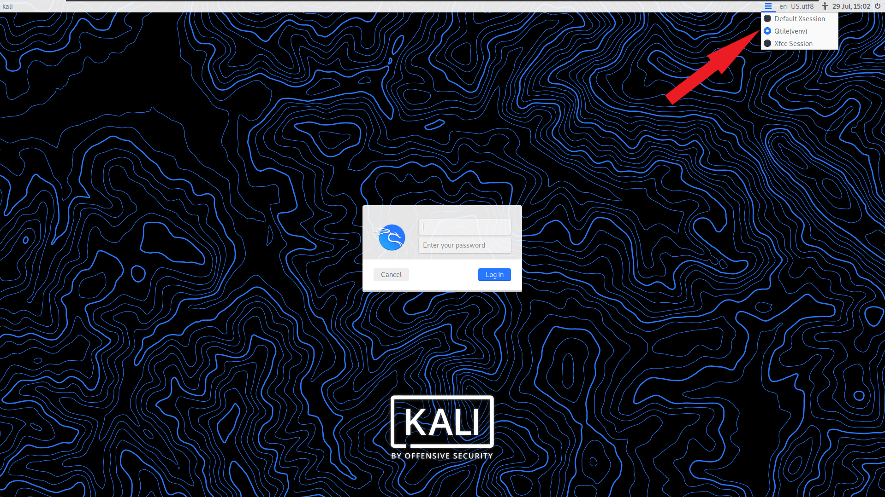

# Qtile — Personal Tiling Window Manager Config

[](https://github.com/vaayroon/qtile/actions/workflows/ci.yml)

A complete, batteries-included [Qtile](https://qtile.org/) configuration for X11: multi-monitor aware, Nerd Font powerline bar, media/brightness keys, and a custom widget to mirror and control an Android phone over wireless ADB + scrcpy.

> Built and tested on Ubuntu 24.04.4 LTS with Python 3.12 and Qtile 0.37.1.



---

## Features

- **Modular config** — keys, groups, layouts, screens, hooks, and widgets live in separate files under `src/modules/`.
- **Dynamic multi-monitor** — screens are detected at startup via `xrandr`; monitor order is configurable by serial or port.
- **11 layouts** — MonadTall, MonadWide, Max, Tile, Stack, TreeTab, Matrix, and more.
- **Powerline status bar** — system updates, crypto ticker, CPU/GPU temps, memory, network, clock, and a system tray.
- **Phone mirroring widget** — start/stop scrcpy, reconnect ADB, and control phone volume straight from the bar.
- **`.env`-driven** — runtime behavior (monitor ordering, phone mirror) is configured through environment variables, not hardcoded.
- **Reproducible deps** — managed and locked with [uv](https://docs.astral.sh/uv/) (`uv.lock`, exact installs); linted, formatted and type-checked with `ruff` and `mypy`, gated by GitHub Actions CI and local pre-commit hooks.

---

## Requirements

- An **X11** session (this config targets the X backend, not Wayland).
- **Python 3.12+** from your distro (`/usr/bin/python3.12`). The venv backs your login session, so `install.sh` builds it on that exact interpreter (override with `PYTHON=/path/to/python3.12 ./install.sh`) and fails if `.venv/pyvenv.cfg` says otherwise; uv never downloads a Python. Merely having a Homebrew or pyenv Python earlier on your `PATH` does not change this.
- **[uv](https://docs.astral.sh/uv/)** — manages the virtual environment and dependencies. `install.sh` requires it but never installs it for you:

  ```bash
  curl -LsSf https://astral.sh/uv/install.sh | sh
  ```

  Other installation methods are listed in the [uv docs](https://docs.astral.sh/uv/getting-started/installation/).
- A **Nerd Font** installed — the bar uses `CaskaydiaCove Nerd Font`. Grab it from [nerdfonts.com](https://www.nerdfonts.com/).
- A display manager that reads `/usr/share/xsessions/` (LightDM, GDM, SDDM, etc.).

---

## Quick start

This config is designed to live at `~/.config/qtile`.

```bash
git clone https://github.com/vaayroon/qtile.git ~/.config/qtile
cd ~/.config/qtile
./install.sh
```

`install.sh` syncs the virtual environment from `uv.lock`, sets up `.env` from
the template, and registers the X session entry (the X session step prompts for
`sudo`). Then **log out and pick "Qtile (venv)"** from your display manager.

Useful flags:

| Flag | Effect |
|---|---|
| `--dev` | Also install the dev tools (`ruff`, `mypy`, `pytest`, `pytest-asyncio`, `pre-commit`). Without it they are removed. |
| `--force` | Recreate the virtual environment. The old one is moved to `.venv.bak` while the new one is synced, restored if the sync fails, and deleted once it succeeds. |
| `--skip-xsession` | Don't touch `/usr/share/xsessions` (no `sudo`). |

> The script is re-runnable. `.env` is never overwritten, and `.venv` is
> converged to `uv.lock` on every run: missing packages are installed and
> unlocked ones are pruned (dev tools included, unless `--dev`). uv leaves the
> venv's seed packages (such as `pip`) alone, so they may still be present.
> Use `--force` to rebuild the venv from scratch. If the sync fails, the script
> exits non-zero before writing `.env` or any session entry.

### Manual setup

Prefer to do it by hand? The steps the script performs:

```bash
uv sync --locked --no-dev                    # 1. .venv + runtime dependencies from uv.lock
cp .env.example .env && $EDITOR .env         # 2. configure
```

Then register the session by creating `/usr/share/xsessions/qtile-venv.desktop`:

```ini
[Desktop Entry]
Name=Qtile (venv)
Comment=Qtile Session
Type=Application
Keywords=wm;tiling
Path=/home/YOUR_USER/.config/qtile
Exec=/home/YOUR_USER/.config/qtile/.venv/bin/qtile start -c /home/YOUR_USER/.config/qtile/src/config.py
```

> ⚠️ Replace `YOUR_USER` with your username. `Exec` and `Path` must be absolute —
> the display manager does not expand `~`. `Path` sets the session's working
> directory (the display manager would otherwise use `$HOME`); `.env` is resolved
> from the config's own location, so it is loaded either way.

### Try it without logging out

Run `./test-xephyr.sh` to test the config in a nested X server ([Xephyr](https://wiki.archlinux.org/title/Xephyr)). It validates the config with `qtile check` first, so a typo never costs you a black screen, then starts Xephyr and Qtile inside it.

```bash
sudo apt install xserver-xephyr        # one-time prerequisite
./test-xephyr.sh                       # display :2, 1920x720
./test-xephyr.sh :3 2560x1080          # custom display and resolution
CHECK_ONLY=1 ./test-xephyr.sh          # validate only, do not launch
```

| Argument | Default | Purpose |
|---|---|---|
| `$1` | `:2` | X display number for Xephyr. |
| `$2` | `1920x720` | Xephyr screen resolution. |

The script needs `.venv/bin/qtile` (run `./install.sh` first) and stops Xephyr when it exits.

### Upgrading from a pip-based install

If your clone's `.venv` was created by an older `install.sh` (pip and
the old requirements files), migrate it once. The session entry does not change, because
it still launches `.venv/bin/qtile`. Do it from a TTY, not from inside the Qtile
session:

1. Install uv and confirm it works: `uv --version`.
2. Log out of the Qtile session and switch to a TTY (for example `Ctrl+Alt+F3`).
3. Update the clone:

   ```bash
   cd ~/.config/qtile
   git switch main && git pull --ff-only
   ```

4. Keep the old environment as a backup and build the new one:

   ```bash
   mv .venv .venv.pip
   ./install.sh --skip-xsession
   ```

5. Check it: `.venv/bin/qtile --version` should print `0.37.1`, then validate the
   config with `.venv/bin/qtile check -c src/config.py` (it needs no X server)
   and log back in.
   A runtime-only venv has no `mypy`/`stubtest`, so `qtile check` prints
   `Missing dependencies. Skipping type checking.` and does not print
   `Your config can be loaded by Qtile.` That is expected: the config was still
   loaded and validated. Success is exit code 0 (`echo $?`); errors print
   `Errors found in config`. Type checking runs in a `--dev` venv.
6. Once everything is stable, delete the backup: `rm -rf .venv.pip`.

**Rollback:** the backup only works under its original name, because the scripts
inside a venv embed absolute paths: `.venv.pip/bin/qtile` points at
`.venv/bin/python`, i.e. at the new environment. From a TTY, run
`rm -rf .venv && mv .venv.pip .venv`. The repository does not need to be reverted
for the old environment to start.

---

## Configuration

Runtime behavior is controlled through `.env` (loaded by `python-dotenv` at startup). Copy `.env.example` and adjust:

### Monitors

| Variable | Default | Purpose |
|---|---|---|
| `QTILE_SCREEN_SERIAL_ORDER` | _(empty)_ | Comma-separated monitor serials, highest priority for ordering. |
| `QTILE_SCREEN_PORT_ORDER` | `DP-0,HDMI-0,DP-2` | Port-name fallback order when serials are missing. |
| `QTILE_INTERNAL_OUTPUTS` | `eDP-1` | Outputs treated as the internal laptop panel. |
| `QTILE_PRIMARY_MONITOR` | _(empty)_ | Force a specific output to be `--primary`. |

### Phone mirroring

| Variable | Default | Purpose |
|---|---|---|
| `QTILE_PHONE_MIRROR_WIRELESS_TARGET` | _(empty)_ | ADB wireless target, e.g. `192.168.1.15:5555`. |
| `QTILE_PHONE_MIRROR_DEVICE` | _(empty)_ | Fixed ADB serial (empty = first device found). |
| `QTILE_PHONE_MIRROR_ADB_PATH` | `/opt/genymobile/adb` | Path to the `adb` binary. |
| `QTILE_PHONE_MIRROR_SCRCPY_PATH` | `scrcpy` | Path to the `scrcpy` binary. |
| `QTILE_PHONE_MIRROR_SCREEN_OFF` | `true` | Start scrcpy with the phone screen off (`-S`). |
| `QTILE_PHONE_MIRROR_SHOW_DEVICE` | `false` | Append the device serial to the bar status text. |
| `QTILE_PHONE_MIRROR_VOLUME_STEP` | `5` | ADB volume key-events sent per scroll tick. |

### Startup

| Variable | Default | Purpose |
|---|---|---|
| `QTILE_AUTOSTART_PATH` | _(empty)_ | Script run once per login (empty = [`autostart.sh`](autostart.sh) from this checkout). |

The script is started in the background; a missing or non-executable script only logs a warning. Its output is written to `$XDG_DATA_HOME/qtile/autostart.log` (default `~/.local/share/qtile/autostart.log`) and truncated each session.

### Terminal

| Variable | Default | Purpose |
|---|---|---|
| `QTILE_TERMINAL` | `/usr/bin/qterminal` | Terminal emulator spawned by the bar widgets' click actions and the `Ctrl + Shift + e` bind (empty = default). `mod + Return` always opens `kitty`. |

### Appearance

Colors, borders, and fonts are defined in [`src/settings.py`](src/settings.py):

- **Mod key**: `Super` (Windows key).
- **Borders**: 2px, focused `#117af0`, normal `#1D2330`, 6px gaps.
- **Bar font**: `CaskaydiaCove Nerd Font`, size 12.

---

## Keybindings

`mod` = `Super` (Windows key).

### Windows & layouts

| Keys | Action |
|---|---|
| `mod + Tab` | Cycle to next layout |
| `mod + j` / `mod + k` | Move focus up / down the stack |
| `mod + Shift + j` / `mod + Shift + k` | Shuffle window up / down |
| `mod + h` / `mod + l` | Grow / shrink window (or adjust master count) |
| `mod + n` | Normalize window sizes |
| `mod + m` | Toggle maximize |
| `mod + Shift + f` | Toggle floating |
| `mod + Shift + m` | Toggle fullscreen |
| `mod + space` | Switch focus between stack panes |
| `mod + Shift + space` | Flip the main pane side |
| `mod + Ctrl + Return` | Toggle split / unsplit |
| `mod + Shift + c` | Close window |
| `mod + Shift + r` | Reload config |
| `mod + Shift + q` | Quit Qtile |

### Groups (workspaces)

| Keys | Action |
|---|---|
| `mod + 1…7` | Switch to group |
| `mod + Shift + 1…7` | Move focused window to group |

### Monitors

| Keys | Action |
|---|---|
| `mod + w` / `mod + e` / `mod + r` | Focus monitor 1 / 2 / 3 |
| `mod + period` / `mod + comma` | Focus next / previous monitor |

### Launchers

| Keys | Action |
|---|---|
| `mod + Return` | Terminal (`kitty`) |
| `mod + Shift + Return` | `dmenu` run prompt |
| `Menu` | App launcher (`rofi`) |
| `mod + Alt + <key>` | Quick-launch apps (browser, files, editor, Spotify, screenshots…) |

### Scratchpad keys

| Keys | Action |
|---|---|
| `mod + º` | Toggle the dropdown terminal (`term`; the key below `Esc` on a Spanish layout) |
| `mod + s`, then `n` / `b` / `c` | Toggle Files / Private browser / Calculator |
| `XF86Calculator` | Toggle the calculator |
| `mod + Ctrl + l` / `mod + Ctrl + h` | Grow / shrink the focused scratchpad (cycles [size presets](#size-presets)) |

> The `mod + s` sub-keys come from `scratchpads.toml`. See [Scratchpads](#scratchpads) to add your own.

### Media, audio & brightness

| Keys | Action |
|---|---|
| `XF86AudioRaise/Lower/Mute` | Volume via `pamixer` |
| `XF86AudioPlay/Next/Prev/Stop` | Playback via `playerctl` |
| `XF86MonBrightnessUp/Down` | Brightness via `brightnessctl` |
| `Ctrl + Alt + l` | Lock screen (`i3lock`) |

> The full, authoritative list lives in [`src/modules/keys.py`](src/modules/keys.py).

---

## Scratchpads

Scratchpads are floating dropdown apps (a quake-style terminal, a calculator…) toggled with a key. They are declared in [`scratchpads.toml`](scratchpads.toml), one `[[scratchpad]]` table per app. Edit that file or, better, keep your changes in [`scratchpads.local.toml`](#personal-overrides), then reload with `mod + Shift + r`.

| Name | App | Toggle |
|---|---|---|
| `term` | `kitty` with [`src/assets/scratchpad/kitty.conf`](src/assets/scratchpad/kitty.conf) | `mod + º` |
| `files` | `nautilus` | `mod + s`, `n` |
| `private` | Brave in incognito, with its own profile directory | `mod + s`, `b` |
| `calc` | `gnome-calculator` | `mod + s`, `c` (or `XF86Calculator`) |

### Add a scratchpad

Append a table with at least `name` and `command`. Add `key` to get a `mod + s` sub-key:

```toml
[[scratchpad]]
name = "notes"
command = "gnome-text-editor --new-window"
match_wm_class = "org.gnome.TextEditor"
key = "t"
```

`match_wm_class` is optional. It is the window class Qtile uses to identify the app's window; find it with `xprop WM_CLASS` (click the app's window).

| Field | Default | Notes |
|---|---|---|
| `name` | required | Unique identifier, used by `dropdown_toggle` (see [Toggle from rofi or a script](#toggle-from-rofi-or-a-script)). |
| `command` | required | Command line to start the app. `{repo}` expands to this config's `src/` directory. |
| `key` | _(empty)_ | Sub-key after `mod + s`. Without it the app has no chord entry. Blank, whitespace or `Escape` skips the whole entry. |
| `x`, `y` | `0.25`, `0.15` | Top-left corner, as a fraction of the screen (`0` to `1`). |
| `width`, `height` | `0.5`, `0.6` | Size, as a fraction of the screen (`0 < v <= 1`). |
| `opacity` | `1.0` | Window opacity (`0` to `1`). |
| `on_focus_lost_hide` | `true` | Hide the dropdown when it loses focus. |
| `warp_pointer` | `true` | Move the pointer to the dropdown when it appears. |
| `match_wm_class` | _(empty)_ | Window class Qtile uses to identify the app's window. |
| `match_title_regex` | _(empty)_ | Regex on the window title, to tell apart windows of one class. Must compile, and needs `match_wm_class` or `profile_dir`. |
| `profile_dir` | _(empty)_ | Separate profile for a Chromium-family browser (`~` is expanded). Qtile appends `--user-data-dir=<dir>` to `command`, so `command` must not contain it, and `match_wm_class` is required. The class to match becomes `"<match_wm_class> (<dir>)"`. |
| `medium_width`, `medium_height`, `small_width`, `small_height` | _(derived)_ | Override the [size presets](#size-presets) (`0 < v <= 1`). An invalid value is ignored with a warning and the entry still loads. |
| `label`, `icon`, `desktop_entry` | n/a | Reserved: accepted and validated, but currently unused. |

A wrong type or an out-of-range value skips that entry with a warning in `qtile.log`; an unknown field is ignored with a warning. See [Troubleshooting](#troubleshooting).

### Personal overrides

Put machine-specific changes in `scratchpads.local.toml`, next to `scratchpads.toml`. It is gitignored, optional, and read from the repository location, not from the current directory.

```toml
# scratchpads.local.toml

# Same name as a shipped entry: replaces it completely.
[[scratchpad]]
name = "calc"
command = "gnome-calculator"
match_wm_class = "gnome-calculator"
key = "k"
width = 0.3

# New name: appended after the shipped entries.
[[scratchpad]]
name = "notes"
command = "gnome-text-editor --new-window"
match_wm_class = "org.gnome.TextEditor"
key = "t"

# enabled = false: removes the shipped entry.
[[scratchpad]]
name = "private"
enabled = false
```

- A local entry with the same `name` **replaces** the base entry in full and keeps its position. Nothing is inherited, so repeat every field you still need (including `medium_*` and `small_*`).
- A local entry with a new `name` is appended.
- `enabled = false` (a real boolean) in the local file removes the base entry of that name. In `scratchpads.toml` it has no effect.
- Within one file, a repeated `name` keeps the first and logs a warning.
- A missing local file is silent. A malformed one logs a warning and contributes no entries; the base file still loads.
- If no valid entry remains, a built-in `kitty` `term` is used. The loader never raises.
- Changes apply on config reload (`mod + Shift + r`).

### Size presets

`mod + Ctrl + l` grows and `mod + Ctrl + h` shrinks the **focused** scratchpad through a fixed cycle that wraps around:

| Preset | Size |
|---|---|
| `full` | Whole screen |
| `medium` | Halfway between the default and full (derived), or `medium_*` |
| `default` | The entry's own `x`, `y`, `width`, `height` |
| `small` | About 60% of the default, at least 5% (derived), or `small_*` |

Grow moves toward `full`, shrink toward `small`. Presets stay centered on the default's center and are clamped to the screen. Presets that coincide with an earlier one are dropped. The size is kept per dropdown across hide and show, resets on config reload, and is never written to disk. The keys do nothing when the focused window is not a dropdown.

### Toggle from rofi or a script

Any entry can be toggled from outside Qtile through its IPC interface:

```bash
.venv/bin/qtile cmd-obj -o group scratchpad -f dropdown_toggle -a <name>
```

`./install.sh` also registers a "Scratchpad Terminal" entry in `~/.local/share/applications/qtile-scratchpad.desktop`, so `rofi -show drun` can toggle `term`. It runs [`src/assets/scratchpad/scratchpad-toggle.sh`](src/assets/scratchpad/scratchpad-toggle.sh), which uses the repository's `.venv/bin/qtile` and falls back to `qtile` on your `PATH`.

---

## The status bar

Left to right, the bar shows: group box → window name → available updates → BTC/EUR ticker → CPU & GPU temps → memory → network → **phone mirror** → clock → current layout → system tray (primary monitor only).

### Phone mirror widget

A custom widget ([`src/widgets/phone_mirror.py`](src/widgets/phone_mirror.py)) that controls scrcpy from the bar:

| Interaction | Action |
|---|---|
| **Left click** | Start / stop mirroring |
| **Right click** | Force wireless ADB reconnect |
| **Middle click** | Toggle "phone screen off" mode |
| **Scroll up / down** | Phone volume up / down |

Status text: `PHONE:READY` (connected, idle) · `PHONE:MIRROR` (running) · `PHONE:DISC` (no device) · `PHONE:ERR` (adb/scrcpy not found). If a binary is missing it opens a `zenity`/`tkinter` dialog to fix paths and targets on the fly.

---

## External tools

The config spawns external programs for keybindings, the bar, and widget click actions. Install the ones you use.

**Core (recommended):**

```bash
sudo apt install kitty rofi suckless-tools pamixer playerctl \
  brightnessctl i3lock flameshot x11-xserver-utils
```

**Status bar & autostart helpers:**

```bash
sudo apt install lm-sensors htop glances \
  cbatticon volumeicon-alsa udiskie network-manager-gnome blueman
```

**Phone mirroring:** [`adb`](https://developer.android.com/tools/adb) and [`scrcpy`](https://github.com/Genymobile/scrcpy) (the config expects them under `/opt/genymobile/`; override via `.env`).

Other optional integrations referenced in keybindings: `nautilus`, `pavucontrol`, `psensor`, `cointop`, `gnome-calendar`, `brave-browser`, `code-insiders`, `spotify`, and remote-desktop clients. None are required — unbound tools simply do nothing when their key is pressed.

---

## Full desktop setup

The sections above cover Qtile itself. To reproduce the rest of the desktop (audio, systray, notifications, themes, display manager, shell and terminal), follow the guide for your distro:

| Distro | Guide | Status |
|--------|-------|--------|
| Kali Linux | [docs/setup/kali.md](docs/setup/kali.md) | Legacy (2022), may be outdated |

---

## Troubleshooting

Start with the logs, then validate the config.

| Log | Path | Notes |
|---|---|---|
| Qtile | `~/.local/share/qtile/qtile.log` | `$XDG_DATA_HOME/qtile/qtile.log`. Scratchpad messages are prefixed `scratchpad registry:` (loading) and `scratchpad size:` (size keys). |
| Autostart | `~/.local/share/qtile/autostart.log` | Output of the autostart script; truncated each session. |

Validate the config without an X server: `.venv/bin/qtile check -c src/config.py` (what to expect is explained in [Upgrading from a pip-based install](#upgrading-from-a-pip-based-install), step 5).

| Symptom | Look for in `qtile.log` | Fix |
|---|---|---|
| `mod + s` chord does nothing | `scratchpad registry: chord leader mod4+s is already bound` | Another binding uses `mod + s`: free it in [`src/modules/keys.py`](src/modules/keys.py). The chord is also absent when no entry has a `key`. |
| `mod + º` or `XF86Calculator` does nothing | `scratchpad registry: mod4+masculine toggles entry 'term', which is not in the registry; binding skipped` (or `XF86Calculator ... 'calc'`) | These two keys toggle `term` and `calc` by name. If your local file disables or renames the entry, the key is not bound. Keep the name, or toggle the new one with the `mod + s` chord. |
| A scratchpad is missing or not loading | `scratchpad registry: entry ... missing required field`, `... expected a ..., got`, `... out of range`, `... skipping` | The entry was skipped. Fix the field the message names (see the [field table](#add-a-scratchpad)). Unknown fields only warn. |
| An entry from the local file does not apply | `scratchpad registry: duplicate entry name=... in ..., keeping first occurrence`, or `... has invalid TOML` | Remove the repeated `name`, or fix the TOML syntax. A file with invalid TOML contributes no entries. |
| The app has no `mod + s` sub-key | `scratchpad registry: dropping chord key ... (reserved or already used by another entry)` | Pick a different `key`. The scratchpad still exists and can be [toggled from a script](#toggle-from-rofi-or-a-script). |
| Only a plain terminal scratchpad exists | `scratchpad registry: no valid entries found, falling back to the built-in terminal` | Every entry failed validation. Read the warnings above that line. |
| `mod + Ctrl + l` / `mod + Ctrl + h` do nothing | Nothing at the default log level | The focused window must be a scratchpad. Focus one first. Start Qtile with `-l DEBUG` to see `scratchpad size: focused window is not a dropdown`. |
| Autostart apps did not start | `startup: autostart: script not found` or `script not executable` | Run `chmod +x autostart.sh`, or check `QTILE_AUTOSTART_PATH`. If the script ran, read `autostart.log`. |
| `Can't grab <Key (['mod4'], masculine)> (unknown keysym: ba)` at startup | The line itself | Harmless. The Spanish layout is applied after Qtile starts; when the keymap changes, Qtile re-grabs every key, so `mod + º` works. |

---

## Development

Dependencies are declared in **`pyproject.toml`** (the single source of truth)
and locked to exact versions in **`uv.lock`**, which is generated: never edit it
by hand and always commit it together with the `pyproject.toml` change that
caused it. The dev tools (`ruff`, `mypy`, `pytest`, `pytest-asyncio`,
`pre-commit`) live in the `dev` dependency group.

```bash
uv sync --locked                 # runtime + dev tools, exactly as locked
                                 # (plain `uv sync` installs the dev group too)

# The checks CI runs
uv run --locked ruff check .
uv run --locked ruff format --check .
uv run --locked mypy src tools
uv run --locked pytest

# Apply the formatter
uv run --locked ruff format .

# Git hooks: install once per clone (ruff and the lock check on commit, mypy on push)
uv run --locked pre-commit install
uv run --locked pre-commit run --all-files                        # on demand
uv run --locked pre-commit run --all-files --hook-stage pre-push
```

> `--locked` makes uv fail instead of silently re-locking when `uv.lock` is out
> of date with `pyproject.toml`.
>
> The hooks are local and run `uv run --locked ...`, so ruff and mypy come from
> `uv.lock` exactly as in CI. A few things to know:
>
> - The hooks call `uv`, so it must be on the `PATH` of whatever runs `git` (a
>   GUI client or an IDE often has a shorter `PATH` than your shell).
> - `./install.sh` without `--dev` removes the dev tools from `.venv`, `pre-commit`
>   included, so the installed git hooks then fail. Run `./install.sh --dev` and
>   `uv run --locked pre-commit install` again to restore them.
> - The `uv lock --check` hook needs network access or a warm uv cache, because
>   it resolves the dependencies to prove the lock is current.

### Upgrading dependencies

Upgrades are manual and one package at a time, so each bump can be checked on its
own:

```bash
uv lock --upgrade-package <pkg>   # bump one package inside its allowed range
uv sync --locked                  # apply the new lock to .venv
uv lock --check                   # verify uv.lock still matches pyproject.toml
```

Run the checks above before committing the new `uv.lock`. Dependabot also
proposes upgrades, see [Continuous integration](#continuous-integration).

Qtile itself is pinned exactly (`qtile==X.Y.Z`), because the config and the tests
rely on libqtile internals. To upgrade it, change the pin in `pyproject.toml`,
`project.version` (it mirrors the pin) and the version in the README banner
together, then run `uv lock --upgrade-package qtile` and `uv sync --locked`. The
contract tests fail if the pin, `project.version`, the README banner and
`uv.lock` disagree.

### Continuous integration

`.github/workflows/ci.yml` runs on every pull request to `main` and on every
push to `main`. It is a single job named `checks` on `ubuntu-24.04` with the
distro Python 3.12 (no download) and uv 0.13.5, and it runs the commands above
in this order: `uv lock --check`, `uv sync --locked`, `ruff check .`,
`ruff format --check .`, `mypy src tools` and `pytest -rs`. Then
`tools/check_junit.py` reads pytest's JUnit report and fails when any test is
skipped, xfailed or xpassed, or when the number of passed tests is not exactly
`EXPECTED_TESTS`, so a deleted or silently skipped test cannot go unnoticed even
though pytest exits 0.

- **`EXPECTED_TESTS`** (in `ci.yml`) is the exact number of tests that must
  pass, not a floor. The commit that adds or removes tests sets it to the new
  count in the same commit (the gate prints the number to use); a difference in
  either direction fails CI, and removing tests needs a commit message saying
  which ones. `xfail_strict` is on in `pyproject.toml`, so an unexpected pass
  fails instead of passing unnoticed.
- **Actions are pinned** to commit SHAs with a `# vX.Y.Z` comment. Dependabot
  updates both together.
- **uv in CI** is pinned in the `setup-uv` step (`version: "0.13.5"`). Dependabot
  does not touch it: bump it by hand when you upgrade the local uv.
- **Dependabot** (`.github/dependabot.yml`) opens weekly grouped pull requests for
  `uv.lock` (minor and patch together, majors alone) and for the actions, after
  a cooldown. `qtile` is ignored: bump it as described above.

#### Branch protection

The owner enables this by hand, once, **after this workflow is merged and the
`checks` job has run on `main`** (GitHub only lets you require a check it has
already seen). Nothing in the repository applies it.

The target protection of `main` keeps the pull request flow ready for outside
contributors and adds CI on top of it:

- the `checks` check is required (from the GitHub Actions app, id 15368) and the
  branch must be up to date before merging (`strict`);
- a pull request needs 1 approving review, from a code owner, and the last push
  must be approved by someone other than its author;
- `enforce_admins` stays off, so the owner, who cannot approve their own pull
  requests, merges them with *Merge without waiting for requirements to be met
  (bypass rules)*.

> **This is a full replacement, not a patch.** `PUT .../protection` overwrites
> every rule of `main`. The payload below restates the review rules `main`
> already has, so running it only adds the required check. Anything set to its
> default (force pushes, deletions, linear history, signatures, conversation
> resolution) is reset to off; check the current rule first if you changed any.

```bash
gh api --method PUT repos/vaayroon/qtile/branches/main/protection --input - <<'EOF'
{
  "required_status_checks": {
    "strict": true,
    "contexts": [],
    "checks": [{"context": "checks", "app_id": 15368}]
  },
  "enforce_admins": false,
  "required_pull_request_reviews": {
    "required_approving_review_count": 1,
    "require_code_owner_reviews": true,
    "require_last_push_approval": true,
    "dismiss_stale_reviews": false
  },
  "restrictions": null
}
EOF
```

`contexts` stays empty because the API schema requires the key; the check itself
goes in `checks`. Confirm the app id before running it
(`gh api /apps/github-actions --jq .id`) and read the result back afterwards:

```bash
gh api repos/vaayroon/qtile/branches/main/protection
```

From the UI, the equivalent is Settings > Branches > the `main` rule: keep
*Require a pull request before merging* and its review options as they are, tick
*Require status checks to pass before merging* and *Require branches to be up to
date before merging*, add `checks`, and leave *Do not allow bypassing the above
settings* unticked.

The bypass is a deliberate trade-off: it lets the owner merge alone and push a
hotfix straight to `main`, but it also skips the `checks` gate, so wait for CI to
go green before using it. If more people get write access, tick *Do not allow
bypassing* (`enforce_admins: true`) so the rules bind everyone.

Renaming the `checks` job in `ci.yml` leaves every pull request waiting for a
check that never reports, which is why a test pins the name.

#### Recommended repository settings

Also manual, also optional, and not applied by anything in the repository:

- **Settings > Actions > General > Workflow permissions**: set the default to
  *Read repository contents and packages permissions*. `ci.yml` already asks for
  `contents: read`, this makes it the default for any future workflow.
- **Settings > Actions > General**: tick *Require actions to be pinned to a
  full-length commit SHA*. Every action here already is, and Dependabot keeps the
  pins fresh.
- **Settings > Advanced Security** (*Code security* in older UIs): enable *Dependabot alerts* (and, if you want,
  security updates). The version updates in `.github/dependabot.yml` work without
  them; alerts are what flag a vulnerable pinned dependency.

---

## Project structure

```
src/
├── config.py        # Qtile entry point — assembles everything
├── settings.py      # Mod key, terminal, colors, fonts, layout theme
├── modules/         # groups · hooks · keys · layouts · mouse · screens · widgets
├── widgets/         # Custom widgets (PhoneMirrorWidget)
├── assets/          # scratchpad/ — kitty.conf and the rofi/script toggle script
└── utils/           # network · scratchpads · scratchpad_size · startup · system helpers
scratchpads.toml     # Scratchpad registry (personal overrides go in scratchpads.local.toml, gitignored)
.github/             # CI workflow (workflows/ci.yml) and Dependabot config
tools/               # check_junit.py: the CI gate on test count and skips
.pre-commit-config.yaml  # Local hooks (ruff, uv lock --check, mypy)
pyproject.toml       # Project metadata + dependency declarations (source of truth)
uv.lock              # Generated uv lock file (exact versions of every package)
.python-version      # Python minor version uv uses (3.12)
.env.example         # Template for runtime configuration
install.sh           # Bootstrap script (uv sync, .env, X session)
test-xephyr.sh       # Validate the config and run it in a nested Xephyr window
docs/setup/          # Per-distro full desktop setup guides
.screenshots/        # README assets
```

---

## License

Personal configuration — use it, fork it, adapt it freely.
